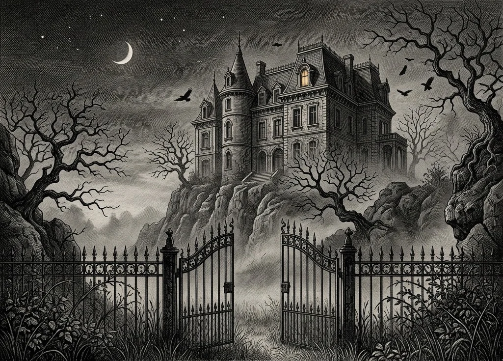

# Le Manoir d’Ombre : Inventaire de Valmorin (1889)

[](https://github.com/mazounirayan/le-manoir-d-ombre/actions/workflows/deploy.yml)
[](https://mazounirayan.github.io/le-manoir-d-ombre/)

> 🕯️ **Visiter l’expérience en ligne** : [https://mazounirayan.github.io/le-manoir-d-ombre/](https://mazounirayan.github.io/le-manoir-d-ombre/)

Expérience web gothique éditoriale et interactive conçue pour démontrer une direction artistique exigeante en **Creative Development**, construite selon une méthodologie stricte **Anti-AI-Slop**.



---

## Direction artistique et parti pris littéraire

Loin des clichés Halloween générés par défaut (dégradés néon orange-violet, emojis, glassmorphism et grilles SaaS à trois cartes), **Le Manoir d’Ombre** puise dans l’édition illustrée française de la fin du XIXe siècle (gravures sur cuivre à la Gustave Doré, portraits clair-obscur, prose inspirée de Baudelaire et Maupassant).

### Les 4 piliers interactifs

1. **Éclairage physique à la chandelle (`CandlelightCanvas`)** : Moteur `<canvas>` 60 FPS simulant une flamme de suif sensible à la vitesse du mouvement (inclinaison au courant d’air), poussières en suspension illuminées uniquement dans le rayon de la bougie, inscriptions murales secrètes révélées par proximité (`HiddenInscription`) et bascule accessible entre *Chandelle* et *Veilleuse*.
2. **Scrollytelling architectural pièce par pièce** : Traversée narrative du domaine (*I. Le vestibule*, *II. La galerie des ancêtres*, *III. Le cabinet et le grimoire*, *IV. La crypte des soupirs*) synchronisée par `IntersectionObserver`.
3. **Accrochage asymétrique de portraits maudits (`PortraitGallery`)** : Ordonnance de salon XIXe siècle (formats verticaux et ferrotype horizontal) avec suivi oculaire mathématique sans re-rendu React et échauffement progressif du vernis au bitume révélant les confessions inscrites au revers des châssis.
4. **Grimoire scellé à double feuillet (`GrimoireBook`)** : Sceau de cire carmin à rompre, feuillets de vélin ancien avec planches anatomiques et astronomiques gravées, et épreuve interactive des cinq veilleuses dévoilant le codicille testamentaire.
5. **Synthèse acoustique procédurale (`manorAudio`)** : Moteur **Web Audio API** sans aucun fichier MP3 externe, strictement *opt-in*, synthétisant en temps réel le souffle du vent sur les falaises, l’échappement irrégulier d’une horloge comtoise (qui retient son treizième battement), le grincement des lattes de parquet, la rupture de la cire et un glas harmonique en ré mineur.

---

## Architecture Anti-AI-Slop et gouvernance Design Engineering

Ce dépôt intègre une chaîne complète de garde-fous pour agents de code et de linters déterministes synthétisée à partir de 7 référentiels open-source :

- **[pbakaus/impeccable](https://github.com/pbakaus/impeccable)** : Contrat `DESIGN.md` lisible par machine et détection déterministe des anti-patterns visuels et d’accessibilité.
- **[Nutlope/hallmark](https://github.com/Nutlope/hallmark)** : Neutres teintés en OKLCH (`chroma >= 0.010`), grille spatiale stricte de `4px`, absence de sourcils (*eyebrows*) au-dessus des titres et hygiène typographique française.
- **[Leonxlnx/taste-skill](https://github.com/Leonxlnx/taste-skill)** & **[LeoStehlik/no-slop-ui](https://github.com/LeoStehlik/no-slop-ui)** : Bannissement des polices surexploitées (`Inter`, `Space Grotesk`, `Geist`), du `backdrop-blur`, des cartes imbriquées et des grilles symétriques génériques.
- **[funboy322/avoid-ai-design](https://github.com/funboy322/avoid-ai-design)**, **[Laith0003/ux-skill](https://github.com/Laith0003/ux-skill)** & **[miqdadbadjuber/anti-slop](https://github.com/miqdadbadjuber/anti-slop)** : Contrastes WCAG AA sur chaque couche tonale, états interactifs complets (`:hover`, `:active`, `:focus-visible`, `:disabled`) et support de `prefers-reduced-motion`.

### Structure des règles embarquées dans le dépôt

```text
le-manoir-d-ombre/
├── DESIGN.md                                         # Contrat de tokens OKLCH, échelle typographique et composants
├── .impeccable.md                                    # Contexte éditorial et anti-références Impeccable
├── AGENTS.md                                         # Directives universelles pour agents IA
├── CLAUDE.md                                         # Point d'entrée Claude Code
├── .cursor/rules/anti-slop-design.mdc                # Règle permanente Cursor IDE
└── .claude/skills/anti-slop-design/
    ├── SKILL.md                                      # Compétence modulaire Agent Skills
    └── references/
        ├── banned-patterns.md                        # Liste noire CSS, typographie, icônes et prose
        └── verification.md                           # Suite de vérification déterministe
```

---

## Stack technique et lancement

- **React 19** + **TypeScript** + **Vite**
- **Tailwind CSS v4** (tokens sémantiques OKLCH natifs via `@theme`)
- **Framer Motion** + **HTML5 Canvas 2D** + **Web Audio API**
- **Icônes gravées sur mesure (`GothicIcons.tsx`)** : Tracés vectoriels `1.5px` dédiés (bougeoir, lanterne, clef de cire, plume, codex)
- Typographie : **Cormorant Garamond** (titrage romain droit), **Spectral** (prose littéraire) et **IBM Plex Mono** (cotes et horodatages)

```bash
# Installation des dépendances
npm install

# Serveur de développement local
npm run dev

# Vérification TypeScript et build de production
npm run build

# Prévisualisation du build de production
npm run preview
```
